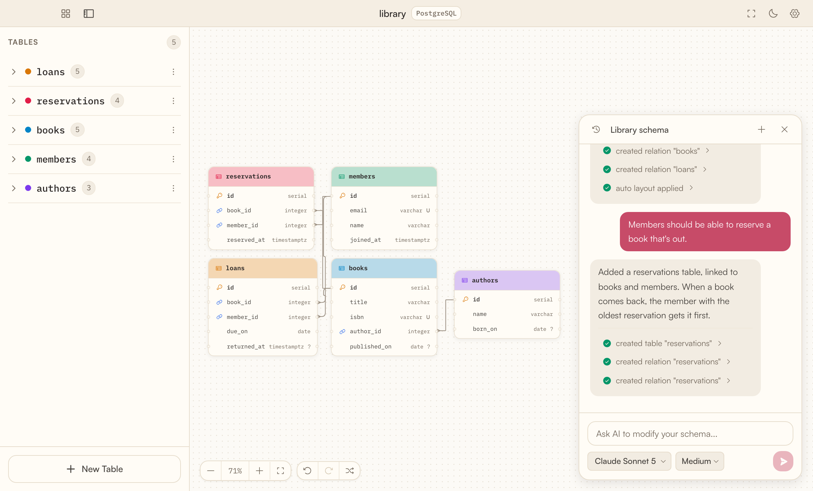

  

<h1 align="center">SocaDB</h1>

  Draw your database, or let your AI handle it.

  <a href="https://socadb.com">Website</a>
  ·
  <a href="https://socadb.com/#download">Download</a>
  ·
  <a href="https://socadb.com/changelog">Changelog</a>
  ·
  <a href="https://github.com/soca-projects/socadb-desktop/releases">Releases</a>

  <picture>
    <source media="(prefers-color-scheme: dark)" srcset=".github/assets/screenshot-dark.webp">
    
  </picture>

SocaDB is a desktop app for designing PostgreSQL and MySQL schemas. Draw tables and relations on a canvas, or ask Claude or Codex to add them while you watch. Each schema is a plain file on your disk, and its SQL is one export away.

## Features

- **A canvas for your schema.** Tables, columns, keys and relations with their cardinality, along with notes, enums, indexes and type parameters such as lengths and precision. Every change can be undone, and the layout can arrange itself.
- **Your AI draws it.** The built-in chat runs Claude or Codex on the Claude or ChatGPT plan you already have, or with an API key, and edits the schema in front of you.
- **From your terminal too.** SocaDB ships an MCP server and registers it with Claude Code, Claude Desktop and Codex, so they can list your schemas, open or create one, and read and edit the one you have open.
- **PostgreSQL and MySQL.** Column types and defaults follow the database, and switching databases adapts the columns.
- **Import and export.** Export the schema as SQL. Import SQL dumps, DBML or JSON, several files at once.
- **A file you keep.** Each schema is a `.soca` JSON file: commit it, diff it, share it. Everything works offline.
- **A native app** for macOS, Windows and Linux, in English and French, with automatic updates. The macOS build is signed and notarized.

## Install

Download SocaDB from [socadb.com](https://socadb.com/#download), or pick an installer from the [latest release](https://github.com/soca-projects/socadb-desktop/releases/latest):

| System | Installer |
| --- | --- |
| macOS, Apple silicon | `SocaDB_<version>_aarch64.dmg` |
| macOS, Intel | `SocaDB_<version>_x64.dmg` |
| Windows | `SocaDB_<version>_x64-setup.exe` |
| Linux | `SocaDB_<version>_amd64.AppImage` or `.deb` |

The AI chat needs either a Claude Code or Codex login on your computer, or an API key added in Settings. The app shows the step to take when one is missing.

## Feedback and contributing

Bug reports, ideas and suggestions are welcome in the [issues](https://github.com/soca-projects/socadb-desktop/issues). See [CONTRIBUTING.md](CONTRIBUTING.md) to run SocaDB from source and propose a change.

## License

The app is free to download and use. Its source code is available under the [PolyForm Shield License 1.0.0](LICENSE): you can use, change and share it for any purpose except offering a product that competes with SocaDB, even a free one. The SocaDB name and logo are not covered by the license.
